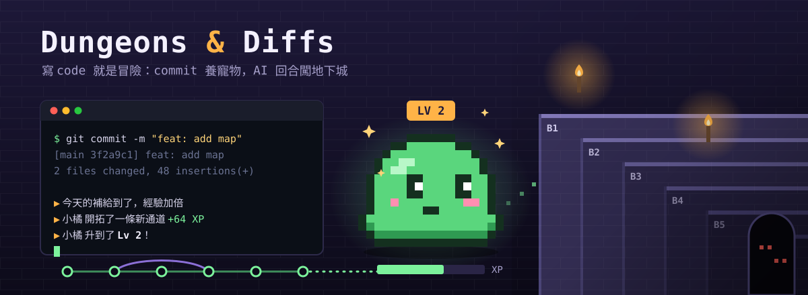

  

# Dungeons & Diffs

**一款跟著你寫程式一起進行的終端機養成遊戲。**

你的每一次 `git commit` 都在餵養一隻住在終端機裡的寵物：`feat` 讓牠開拓新通道、`fix` 讓牠修好搖搖欲墜的橋，經驗累積之後就會升級。和 Claude Code 或 Codex 一起工作時，每個 AI 回合會帶著牠往無盡地下城再下探一層，但 AI 只能帶路、不能幫牠回血，倒地之後要靠你的下一個 commit 把牠救回來。

不需要另外花時間「玩」，遊戲就藏在你平常的開發流程裡：

- **commit 就是經驗**：依 Conventional Commits 的類型與改動量給分，每天前幾筆還有補給加倍。
- **寵物會餓、會想你**：飽足與心情會隨時間下降，太久沒 commit，牠會餓到經驗減半。
- **AI 回合闖地下城**：Claude Code、Codex 的工作推進樓層、打怪、收服怪物，每 10 層有 Boss。
- **職業、進化與轉生**：依你的 commit 習慣決定職業，一路成長到終職後還能轉生重來。
- **全部在本機、可以重播**：所有事件寫進一份只追加的紀錄，同樣的歷史永遠養出同樣的寵物。

> 目前是單人開發中的早期版本：寵物與 git 已經能玩，地下城、AI 整合、職業與轉生會在之後的迭代陸續加入。

安裝與使用方式見 [docs/USAGE.md](docs/USAGE.md)。
